  

  
  
  
  
  

## 🧠 About me

  

- 🎓 **MS in Artificial Intelligence** — Air University, Islamabad (2022–2024), specialising in **Computer Vision**
- 🔬 Thesis: **breast-cancer classification & segmentation from MRI**
- 🤖 Freelance **AI developer** since 2022 — deep-learning and computer-vision models, from data cleaning to deployment
- 🌐 Freelance **web developer** since 2019 — responsive, fast websites and web apps with Laravel, Vue.js and React
- ⚡ Fun fact: I built a Valentine's proposal site where the **NO** button is mathematically uncatchable 😄

## 🛠️ Tech stack

  
  
  
  
  
  
  

  
  
  
  
  
  
  
  
  
  
  

  
  
  
  

## 🚀 Featured projects

  
  
  
  

  <a href="https://msaadshahid1.github.io/valentine-question/"><b>💘 Try the Valentine site live →</b></a>

## 🛤️ My journey

  

  
📄 Text version

| Year | Milestone |
| --- | --- |
| 2017–2021 | BS Information Technology — University of Sargodha |
| 2018–2019 | Web Developer Intern — Dixeam |
| 2019–now | Freelance Web Developer — Laravel, Vue.js, PHP |
| 2021–2022 | AI Developer Intern — DataYard (computer vision) |
| 2022–2023 | Data Mining (part-time) — Ares Projects |
| 2022–2024 | MS Artificial Intelligence — Air University, Islamabad |
| Now | Freelance AI &amp; Web Engineer — open to new projects |

## 🤝 Let's work together

I'm available for freelance **AI / machine-learning**, **computer-vision** and **web-development** projects — from a model that needs training to a website that needs to feel alive.
Find me on [LinkedIn](https://www.linkedin.com/in/muhammad-saad-shahid-068ba519b/), visit my [portfolio](https://msaadshahid1.github.io/), or [send an email](mailto:bilalft05@gmail.com).

