

<a href="https://msaadshahid1.github.io/"></a><a href="https://x.com/Muhamma06001032"></a><a href="mailto:bilalft05@gmail.com"></a>
<a href="https://github.com/MSaadShahid1/valentine-question"></a><a href="https://github.com/MSaadShahid1/ScholarMind"></a>
<a href="https://github.com/MSaadShahid1/healthcare-claims-pipeline"></a><a href="https://msaadshahid1.github.io/"></a>

<a href="mailto:bilalft05@gmail.com"></a>
  

